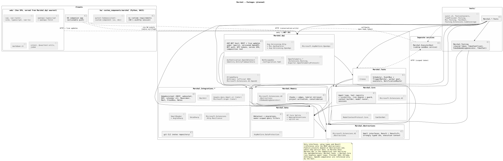
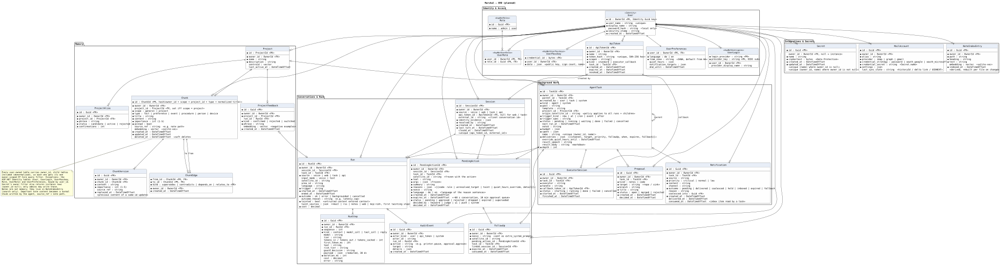

# Marshal

**Your home's own AI assistant. Private, capable, and it knows when to ask first.**

Marshal is a self-hosted AI agent for Home Assistant. Talk to it through any Assist voice satellite, the Home Assistant app, or its own web interface. It runs your 3D printer, reads your mail, prepares your morning, remembers what matters to you, and keeps working in the background while you get on with your day.

> **Status:** Marshal is in early development. The design is being finalized; nothing is ready to install yet. Star or watch the repository to follow along.

<!-- Screenshot: hero image — voice satellite + web dashboard -->

---

## Why Marshal?

Voice assistants are either locked into someone else's cloud or limited to switching lights on and off. Marshal is different:

- **It's yours.** Marshal runs on your own hardware, next to Home Assistant. Use local models, cloud models, or a mix of both.
- **It actually does things.** Printer, mail, news, calendar, notes, your whole smart home — Marshal connects them and works across them.
- **It asks before it matters.** Harmless actions just happen. Anything risky, like heating the printer or unlocking a door, needs your clear "yes" first. Some things, like sending an email on your behalf, it simply cannot do.
- **It remembers.** Marshal learns your preferences, your projects and your habits, and brings the right context to each conversation, without you having to repeat yourself.
- **It keeps working when you walk away.** Hand off a task, and Marshal lets you know when it's done, in the room you're in.

---

## What Marshal can do

### 🖨️ Look after your 3D printer
Ask how your print is going, start the next job, or check a camera snapshot. Marshal can watch a print for you, pause it when something looks wrong, and tell you the moment it's finished.

<!-- Screenshot: printer page -->

### ☀️ Brief you every morning
Walk into the kitchen and hear what matters today: your calendar, important mail, the news you actually care about, and what happened overnight. Want the details? Just ask, or open the full version on your phone.

### ✉️ Keep on top of your inbox
Marshal reads your mail across all your accounts, tells you what's important, and prepares reply drafts for you to review. It never sends anything itself. You stay in control.

### 📰 Filter the news for you
Connected to your RSS reader, Marshal picks the stories that fit your interests, summarizes them, and learns what you want more or less of.

### 🏠 Understand your home
Marshal works with your Home Assistant devices and knows which room you're talking from. "Turn on the light" means *this* light.

### 🧠 Remember what matters
Tell Marshal something once and it will remember it. It keeps track of your projects and recognizes what you're talking about, even when you don't say the name. You can see and edit everything it remembers.

<!-- Screenshot: memory graph -->

### ⏱️ Work in the background
"Remind me about the filament order when I get home." "Ask me tomorrow if the fan is working." "Look into this and tell me tonight." Marshal schedules its own follow-ups and delivers results at the right moment, without waking you at night.

### 📝 Suggest, never overwrite
When Marshal wants to change your notes or code, it prepares a proposal for you to review and approve.

### 🧩 Grow with you
Teach Marshal new skills, connect new tools, and create specialized assistants for different jobs, without touching its code.

---

## A web interface that shows everything

Marshal comes with its own web app, built for desktop and phone:

- **Chat** with Marshal when you can't talk out loud
- **Approve** actions and review proposals with one tap
- **See** what Marshal did, why it did it, and what it cost
- **Explore and edit** everything Marshal remembers
- **Follow** your printer live

<!-- Screenshot: web chat + approvals on mobile -->

---

## Speaks your language

Marshal understands and answers in both **English** and **German**.

---

## Private by design

- Runs entirely on your own network
- Works with fully local AI models if you prefer
- Log in with your own identity provider, or with a passkey
- You decide how long conversation history is kept

---

## Getting started

Installation instructions will follow once the first release is available.

---

## Architecture

For the curious: how Marshal is put together. The diagrams are kept up to date with the code; sources and details are in [docs/diagrams](docs/diagrams/).

### Packages

### Data model

---

## License

Marshal is released under the [MIT License](LICENSE).
