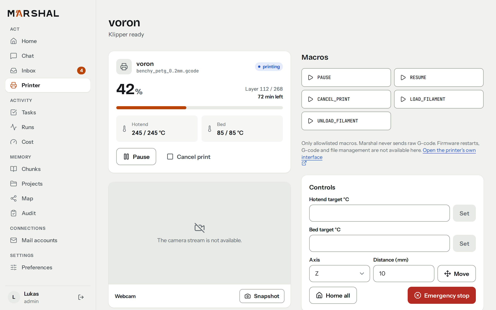

# Marshal

**Your home's own AI assistant. Private, capable, and it knows when to ask first.**

Marshal is a self-hosted AI agent for Home Assistant. Talk to it through any Assist voice satellite, the Home Assistant app, or its own web interface. It runs your 3D printer, reads your mail, prepares your morning, remembers what matters to you, and keeps working in the background while you get on with your day.

> **Status:** Marshal is in early development. All planned features are implemented and tested, but there is no release yet: you build the image yourself, and things may still change without notice.

<!-- Screenshot: hero image — voice satellite + web dashboard -->

---

## Why Marshal?

Voice assistants are either locked into someone else's cloud or limited to switching lights on and off. Marshal is different:

- **It's yours.** Marshal runs on your own hardware, next to Home Assistant. Use local models, cloud models, or a mix of both.
- **It actually does things.** Printer, mail, news, calendar, notes, your whole smart home — Marshal connects them and works across them.
- **It asks before it matters.** Harmless actions just happen. Anything risky, like heating the printer or unlocking a door, needs your clear "yes" first. Some things, like sending an email on your behalf, it simply cannot do.
- **It remembers.** Marshal learns your preferences, your projects and your habits, and brings the right context to each conversation, without you having to repeat yourself.
- **It keeps working when you walk away.** Hand off a task, and Marshal lets you know when it's done, in the room you're in.

---

## What Marshal can do

### 🖨️ Look after your 3D printer
Ask how your print is going, start the next job, or check a camera snapshot. Marshal can watch a print for you, pause it when something looks wrong, and tell you the moment it's finished.

<!-- Screenshot: printer page -->

### ☀️ Brief you every morning
Walk into the kitchen and hear what matters today: your calendar, important mail, the news you actually care about, and what happened overnight. Want the details? Just ask, or open the full version on your phone.

### ✉️ Keep on top of your inbox
Marshal reads your mail across all your accounts, tells you what's important, and prepares reply drafts for you to review. It never sends anything itself. You stay in control.

### 📰 Filter the news for you
Connected to your RSS reader, Marshal picks the stories that fit your interests, summarizes them, and learns what you want more or less of.

### 🏠 Understand your home
Marshal works with your Home Assistant devices and knows which room you're talking from. "Turn on the light" means *this* light. It also knows your energy use, your to-do lists, and reminds you of things when you arrive somewhere.

### 🎵 Play music and find movies
"Play Innuendo" starts the album on the speaker in the room you're in. Move the music to the living room, group speakers, or skip a track, all through Music Assistant. Looking for a film? Marshal finds it, asks you to confirm, requests it through Seerr, and can tell you when it's ready to watch in Jellyfin.

### 📺 Show it on the screen
Photos, videos, code, and 3D models go to the TV nearest you. Marshal renders 3D prints as pictures and can look at a model, image, or page to answer questions about it.

### 🖥️ Keep an eye on your homelab
Marshal hears from Uptime Kuma and Proxmox when something goes down, can tell you what's running, and reads your GitHub pull requests and failed CI runs. It only looks: it never changes your servers or code.

### 🧠 Remember what matters
Tell Marshal something once and it will remember it. It keeps track of your projects and recognizes what you're talking about, even when you don't say the name. You can see and edit everything it remembers.

<!-- Screenshot: memory graph -->

### ⏱️ Work in the background
"Remind me about the filament order when I get home." "Ask me tomorrow if the fan is working." "Look into this and tell me tonight." Marshal schedules its own follow-ups and delivers results at the right moment, without waking you at night.

### 📝 Suggest, never overwrite
When Marshal wants to change your notes or code, it prepares a proposal for you to review and approve.

### 🧩 Grow with you
Teach Marshal new skills, connect new tools, and create specialized assistants for different jobs, without touching its code.

---

## A web interface that shows everything

Marshal comes with its own web app, built for desktop and phone:

- **Chat** with Marshal when you can't talk out loud, and pick up any earlier conversation, typed or spoken
- **Watch it think**: see the model's reasoning and each tool step while a reply streams in
- **Approve** actions and review proposals with one tap
- **See** what Marshal did, why it did it, and what it cost
- **Explore and edit** everything Marshal remembers
- **Follow** your printer live

<!-- Screenshot: web chat + approvals on mobile -->

---

## Speaks your language

Marshal understands and answers in both **English** and **German**.

---

## Private by design

- Runs on your own hardware, on your own network
- Works with fully local AI models if you prefer. Only the services you choose to connect (for example a cloud AI model or your Gmail account) are reached over the internet
- Log in with your own identity provider, or with a passkey
- You decide how long conversation history is kept

---

## Getting started

There is no published image yet; Marshal is built from this repository with Docker. The [quick start](docs/getting-started/quick-start.md) walks you through configuring, starting and connecting Marshal to Home Assistant.

- Everything Marshal stores lives in `/data`; `/config` holds no secrets and can live in git.
- The full list of settings is in the [configuration reference](docs/configuration/index.md).
- Want to look around first? [Demo mode](docs/guides/demo-mode.md) simulates Home Assistant, a printer, mail, news and notes and fills every view with sample history. You only need a model.
- If Marshal does not start, `docker compose logs marshal` lists every configuration problem with its file and key. See [troubleshooting](docs/guides/troubleshooting.md).

---

## Documentation

- [Documentation home](docs/index.md): reading paths for new users, voice users, integrators and contributors
- [Quick start](docs/getting-started/quick-start.md)
- [Configuration](docs/configuration/index.md)
- [Architecture](docs/concepts/architecture.md)
- [FAQ](docs/faq.md) and [roadmap](docs/roadmap.md)
- [Contributing](CONTRIBUTING.md), [security policy](SECURITY.md) and [support](SUPPORT.md)

---

## Architecture

For the curious: how Marshal is put together, explained in [Architecture](docs/concepts/architecture.md). The diagrams are kept up to date with the code; sources and details are in [docs/diagrams](docs/diagrams/).

### Packages

### Data model

---

## License

Marshal is released under the [MIT License](LICENSE).
