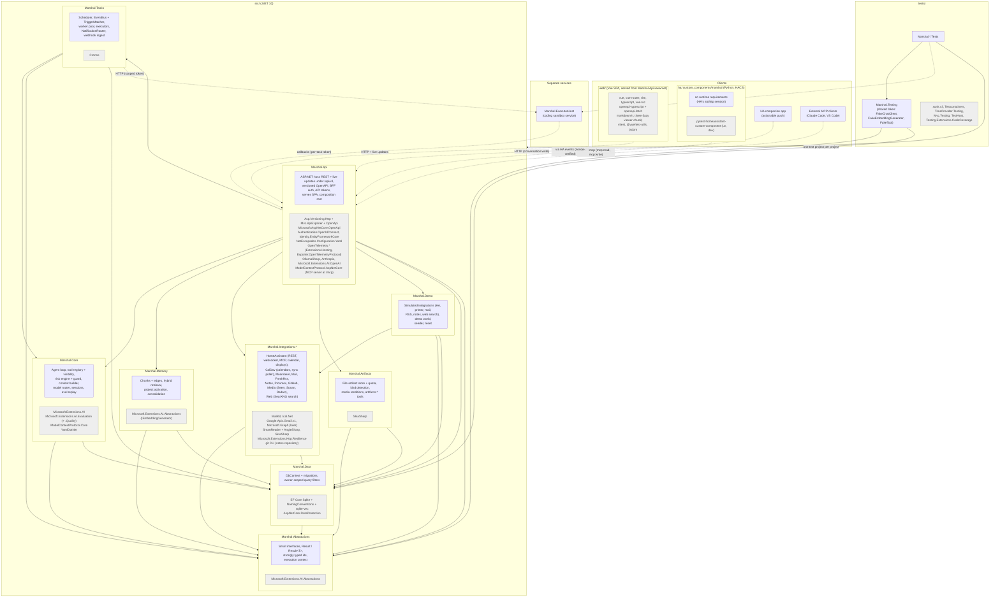
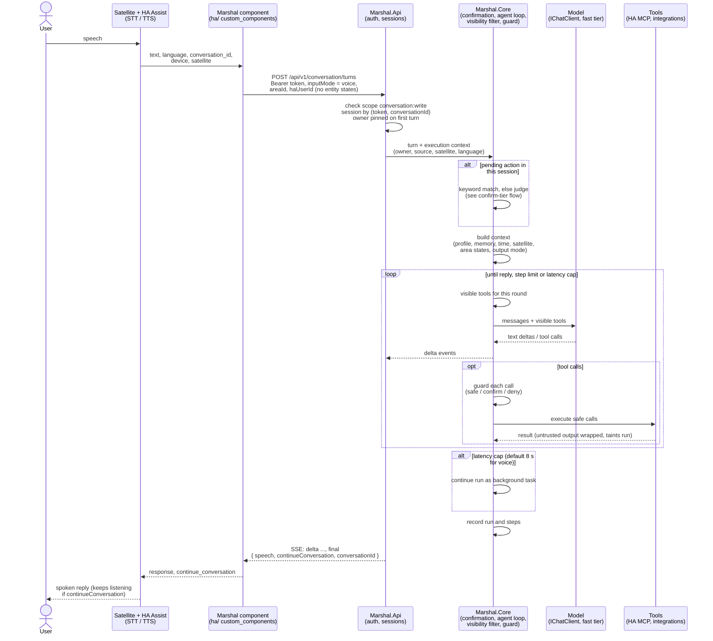

# Architecture

This page explains how Marshal is put together: which processes run, how the projects depend on each other, and why the boundaries sit where they do.

## The problem

A home assistant that talks to an LLM touches many things at once: Home Assistant, printers, mail, feeds, notes, media servers, infrastructure and a coding sandbox. Each of these has its own protocol, failure modes and risks. If the agent code talks to them directly, three things go wrong:

- One broken integration takes the whole agent down.
- Every integration needs its own safety checks, and some will be missed.
- Tests need real services and a real LLM, so they are slow and flaky.

Marshal answers this with one central harness that every request goes through, and small interfaces between the harness and everything else.

## The parts

Marshal runs as one ASP.NET container plus an optional, separate executor host:

| Part | Role |
|---|---|
| `Marshal.Api` | The host. Serves the versioned REST API with SSE streaming, authentication, webhooks and the web UI. It is the only project that references provider SDKs (Ollama, Anthropic, OpenAI-compatible). |
| `Marshal.Abstractions` | Small shared interfaces (`IChatClient` access, tools, channels, executors, `Result`). Feature projects depend on these, not on each other. |
| `Marshal.Core` | The agent harness: agent loop, tool registry, visibility filter, risk engine and guard, context builder, model router, sessions, confirmations, MCP client, skills and templates. |
| `Marshal.Memory` | Memory chunks, hybrid retrieval, project activation and consolidation. |
| `Marshal.Tasks` | Durable tasks, scheduler and worker pool, event bus and trigger matching, deliveries, notifications, approval queue, follow-ups, executors, system jobs and webhook ingest. |
| `Marshal.Integrations.*` | One project per integration (Home Assistant, Moonraker, mail, FreshRSS, notes, media, Proxmox, GitHub). Each contributes tools, event sources or context behind the shared interfaces. |
| `Marshal.Artifacts` | The artifact store and its renditions. |
| `Marshal.Demo` | Demo mode: simulated Home Assistant, printer, mail, RSS and notes behind the same interfaces, plus the sample data seeder. Only `Marshal.Api` references it, and it never contacts a network host. See [demo mode](../guides/demo-mode.md). |
| `Marshal.Data` | EF Core on SQLite, migrations, owner-scoped query filters. |
| `Marshal.ExecutorHost` | A separate service for coding sessions. It has its own image and deployment and is never referenced by Marshal. See [executor host](../installation/executor-host.md). |
| `web/` | The Vue single-page app, built into the host's `wwwroot`. |
| `ha/` | The Home Assistant custom component that makes Marshal a conversation agent for Assist. |

Clients reach Marshal in three ways: Home Assistant Assist through the custom component (the main interface), the web UI, and the public API. All three use the same turn endpoint, `POST /api/v1/conversation/turns` (see [conversation API](../api/conversation.md)).

## How a request moves through it

1. Assist hands the transcribed text to the Marshal component, which forwards it with the satellite, area, language and input mode. It sends no entity states.
2. `Marshal.Api` authenticates the machine token, checks the `conversation:write` scope and looks up or creates the session.
3. `Marshal.Core` checks for a pending confirmation, then runs the [agent loop](agent-loop.md): build the context, call the model with the visible tools, guard every call, execute, repeat.
4. Tools reach Home Assistant (through its MCP server and REST / websocket APIs), printers, mail and other integrations.
5. The reply streams back as SSE `delta` events and ends with a final event carrying `speech` and `continueConversation`. The web UI also receives `reasoning` and `tool` events for the same turn; token clients such as Home Assistant never do.

Background work (scheduled tasks, event watches, approvals) uses the same loop and the same guard, without an HTTP request. See [tasks and scheduling](tasks-and-scheduling.md).

## Design rules behind the boundaries

**Small interfaces everywhere.** Every integration and subsystem sits behind a small interface, even with exactly one implementation: `IChatClient`, `IEmbeddingGenerator`, `IMailProvider`, `INotificationChannel`, `IExecutor`, `ISecretStore`, `IRiskTargetResolver`, `IContextContributor`, `IRunRecorder`. Tests replace them with hand-written fakes, so no test needs a real LLM or a real service.

**Provider neutrality.** All chat models go through `IChatClient` and all embedding models through `IEmbeddingGenerator`. Three provider kinds exist: `ollama`, `openai-compatible` and `anthropic`. Only `Marshal.Api` references the provider SDKs, so the harness never depends on a vendor. Models are chosen by tier (`fast`, `standard`, `advisor`) and capability (`vision`, `tools`, `contextLength`), not by name. See [`models`](../configuration/marshal-yaml/models.md).

**One harness, one guard.** Built-in tools, MCP tools and skills all go through the same registry, visibility filter and guard. An integration cannot bypass them.

**Failure isolation.** An MCP server that fails to start, or a tool source that collides with a reserved namespace, is rejected alone; everything else keeps working. A tool that throws gives the model an error result instead of ending the turn. Memory retrieval that fails lets the turn continue without memory, so device control never depends on the embedding server.

**Configuration as files, secrets by name.** `/config` holds YAML and Markdown that you can keep in git. It never holds secret values, only secret names that `ISecretStore` resolves. See [security model](security-model.md).

**Versioned API in code.** API versions are declared once in code and never in configuration, so a configuration change cannot change the contract a client sees.

## Trade-offs

- **One process, in-process event bus.** The event bus is an in-process channel, and tasks live in SQLite. This keeps deployment to one container and survives restarts, but Marshal does not scale out horizontally.
- **SQLite.** One file, easy to back up, with FTS5 and `sqlite-vec` for search. Concurrency is limited compared to a server database, which is acceptable for one household.
- **Own agent loop.** Marshal does not let the model client invoke tools automatically. The loop is thin and Marshal-owned, so every call passes the guard and is recorded. The cost is that Marshal maintains its own loop instead of using a framework's.
- **Separate executor host.** Coding sessions need Docker. Keeping them on another host means the main container never needs a Docker socket, at the cost of a second deployment.

## Related

::: cards
- [Agent loop](agent-loop.md)
- [Security model](security-model.md)
- [Volumes and layout](../installation/volumes-and-layout.md)
- [Development overview](../development/index.md)
:::
