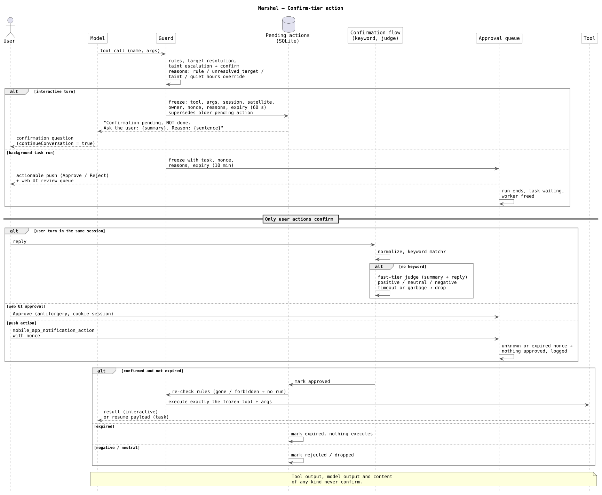

# Risk and confirmation

This page explains how Marshal decides whether a tool call runs, needs your confirmation or never runs, and why confirmed actions are frozen on the server.

## The problem

An agent that can unlock doors, start prints and create reminders must not act on every idea the model has. Asking for confirmation helps, but naive confirmation has holes:

- The model asks "shall I unlock the front door?", you say yes, and the model then calls the tool with different arguments.
- A mail or web page contains the word "confirmed", and the model treats it as your answer.
- A confirmation question hangs around for an hour and a stray "yes" later executes it.
- A rule that protects locks is bypassed by turning off "everything in the hall", which includes a lock.

## Risk tiers

Every tool call has exactly one tier:

| Tier | Meaning |
|---|---|
| `safe` | Execute immediately. |
| `confirm` | Execute only after a user action confirms it. |
| `forbidden` | Never execute. |

Capabilities that must never happen, such as sending mail or raw G-code, are not tools at all. A tier could be changed by a rule; an absent tool cannot. See [risk tiers](../reference/risk-tiers.md).

## Rules

Rules live in `/config/risk.yaml`. They match tool ids by glob, optionally with argument or target conditions (`domain`, `deviceClass`), in order; the first match wins. Tools with no matching rule use their descriptor's default tier. External tools with no matching rule default to `confirm`. The rules apply identically to built-in and external tools and reload without restart. See [`risk.yaml`](../configuration/risk-yaml.md) and [risk rules](../guides/risk-rules.md).

### Targets fail closed

Rules with target conditions are evaluated on the concrete targets a call resolves to, not on its arguments as written. For Home Assistant, a resolver expands `name`, `area`, `floor`, `domain` and `device_class` to the exposed entities. Each target is checked and the highest tier wins, so "turn off the hall" is `confirm` when the hall contains a lock.

A call whose targets cannot be resolved, resolve to nothing, or belong to a namespace without a resolver while a target rule matches, is `confirm` with reason `unresolved_target`. When Marshal is unsure, it asks.

### Taint only raises tiers

When a run has read untrusted content (mail, RSS, notes, calendar, untrusted MCP tools, event payloads), calls to tools flagged `persists` are escalated from `safe` to `confirm` with reason `taint`. See [untrusted content](untrusted-content.md). No stage of the guard ever lowers a tier.

## Frozen pending actions

When a call resolves to `confirm` in an interactive turn, Marshal does not ask the model to remember it. It stores a **pending action** on the server, before anyone is asked:

- tool and exact arguments
- session, satellite and owner
- a nonce
- the reasons
- an expiry (default 60 seconds, `confirmation.ttl`)

The tool result tells the model that confirmation is pending and that the action was not done, and gives the reason sentence the question must include. The turn ends with `continueConversation = true`, so a voice satellite keeps listening.

On confirmation, Marshal executes exactly the stored tool and arguments. The model cannot change them. Before executing, Marshal checks the rules again; a frozen call whose tool is gone or is now `forbidden` does not run.

There is at most one pending action per session. A new confirm-tier call supersedes the old one, which is marked `superseded`. Closing an idle session, or resting an idle web chat session, drops its pending action.

## How you confirm

Only user actions confirm:

- **A user turn in the same session.** This is the normal voice path.
- **A web UI approval.**
- **A nonce-verified push action** from the Home Assistant companion app.

Tool output, model output and content of any kind never confirm. If a tool result contains "confirm" while an action is pending, the action stays pending.

### Keyword, then judge

On the next user turn, Marshal normalizes the full utterance (trim, lowercase, strip punctuation) and compares it with the confirmation keywords for the request language. The built-in lists are `confirm`, `confirmed`, `approved`, `yes do it` (English) and `bestätigt`, `bestätigen`, `ja mach`, `ja mach das` (German); you can replace them per language with `confirmation.keywords`. An exact match executes the frozen action without a model call. "Bestätigt!" matches; "bestätigt, aber erst morgen" does not.

Without a keyword match, a `fast`-tier judge receives only the action summary and your reply, at temperature 0, and answers exactly one of:

| Verdict | Effect |
|---|---|
| `positive` | The frozen action executes. |
| `neutral` | The action is dropped and your message is handled as a normal new turn. |
| `negative` | The action is dropped and Marshal replies that it was cancelled. |

The judge is told to answer `neutral` when it is not sure. A judge timeout (default 3 seconds, `confirmation.judgeTimeout`) or unparsable output drops the action. Confirming after the expiry executes nothing; the action is marked `expired` and the reply says so.

See [`confirmation`](../configuration/marshal-yaml/confirmation.md).

## Reasons

Every pending action carries one or more reasons, each with a code and a short sentence in the request language:

| Code | When |
|---|---|
| `rule` | A risk rule made the call `confirm`. |
| `unresolved_target` | The targets could not be resolved. |
| `taint` | The run read untrusted content and the tool persists state. The sentence names the source, for example that the conversation included mail content, which can contain hidden instructions. |
| `quiet_hours_override` | A task or watch would notify you during quiet hours. |

The server writes these sentences, so the explanation exists even if the model leaves it out. When several reasons apply, `taint` is the one spoken.

## Background runs

A task run has nobody to ask in the moment. A confirm-tier call there creates the same kind of frozen action, with a 10-minute TTL (`tasks.approvalTtl`), and sends it to the approval queue with an actionable push. The run ends instead of holding a worker. See [tasks and scheduling](tasks-and-scheduling.md) and [approvals](../guides/tasks/approvals.md).

## Satellites and subagents

On a satellite with `denyConfirm` for a tool, a call that resolves to `confirm` is denied with "not allowed from this device", and no pending action is created. A subagent's confirm-tier call is denied with a message telling it to report the needed action to its caller.

## Recorded decisions

Every guard decision is recorded on the run step: `safe`, `pending`, `confirmed_by_keyword`, `judge_positive`, `judge_neutral`, `judge_negative`, `escalated_by_taint`, `denied`, `expired`. The run detail shows why each call ran or did not.

## Trade-offs

- **Short TTL.** Sixty seconds is short on purpose: a confirmation belongs to the conversation that raised it. You will sometimes have to ask again.
- **A judge that prefers neutral.** Marshal would rather drop an action and treat your reply as a new request than execute on a misread "sure, but later".
- **Fail closed on targets.** Unknown device names ask for confirmation, which adds friction when an entity is not exposed to Assist.

## Related

- [Tool visibility](tool-visibility.md)
- [Untrusted content](untrusted-content.md)
- [Security model](security-model.md)
- [Follow-ups](../guides/voice/follow-ups.md)
