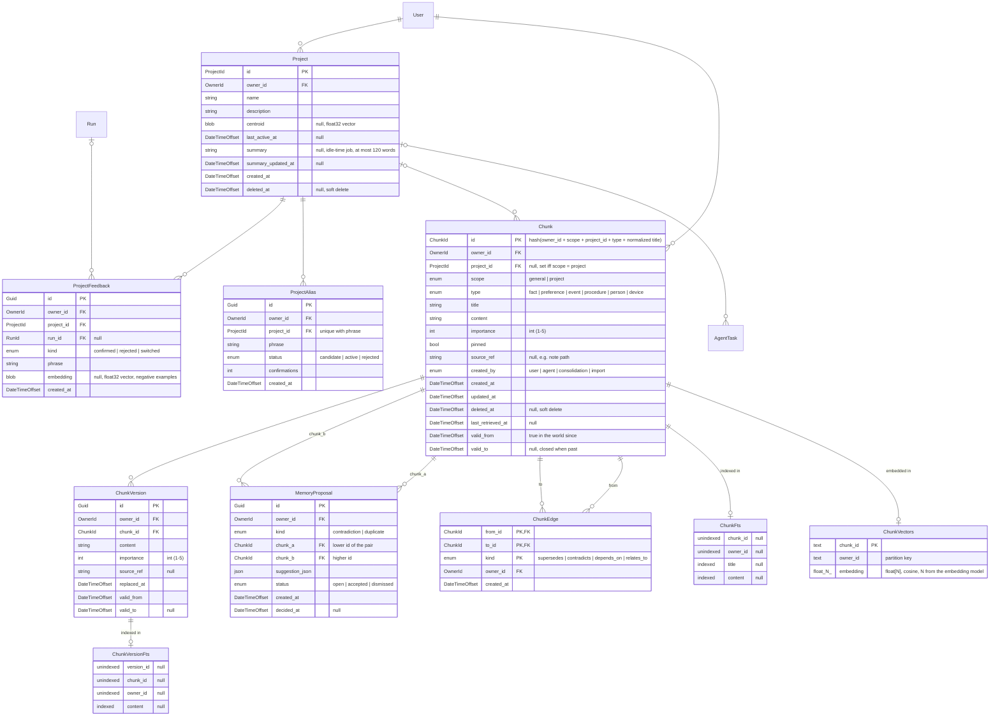
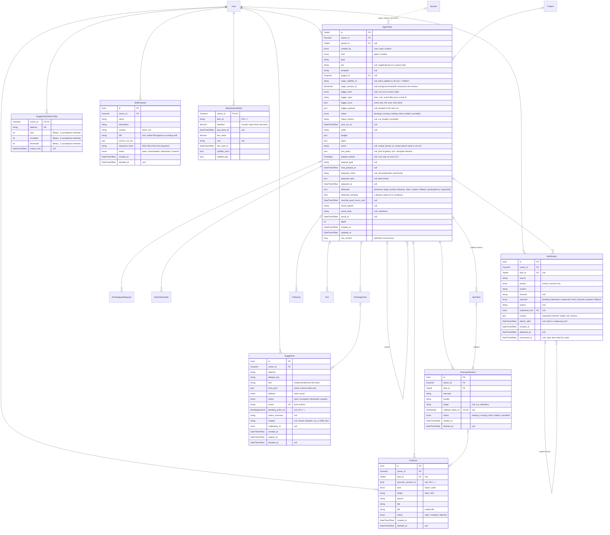

# Data model

Every EF Core entity of `Marshal.Data` with its columns and relationships, one diagram per area. Entities from other areas appear as plain boxes where a relationship crosses areas.

In the attribute comments, `null` marks a nullable column; `PK`, `FK` and `UK` (unique) mark keys.

> [!NOTE]
> Every user-owned table carries `owner_id`, child tables included (denormalized), so each one gets its own owner-scoped EF Core query filter. Exceptions: the ASP.NET Identity tables (`User`, `UserLogin`, `UserPasskey`, `Role`, `UserRole`) and `UserPreferences`, keyed by `user_id`. The owner filter of `Secret` also returns instance rows (`owner_id` null); only admins may write those. Notes are not memory: they live in `NoteIndexEntry` (search only). Important note content becomes a normal `Chunk` written by the agent, with `source_ref` set to the note path.

## Identity and access

Users, logins, passkeys, roles, API tokens, authentication tickets and preferences.

```mermaid
erDiagram
%% KEEP UP TO DATE: must match the EF Core model in src/ (Marshal.Data). Update it in the same change that adds,
%% removes or renames an entity, column or relationship (see docs/diagrams/README.md).
    User {
        OwnerId id PK "Identity key (IdentityUser<OwnerId>)"
        string user_name "null"
        string normalized_user_name UK "null"
        string email "null"
        string normalized_email "null"
        bool email_confirmed
        string password_hash "null, local only"
        string security_stamp "null"
        string concurrency_stamp "null"
        string phone_number "null"
        bool phone_number_confirmed
        bool two_factor_enabled
        DateTimeOffset lockout_end "null"
        bool lockout_enabled
        int access_failed_count
        string display_name
        DateTimeOffset created_at
    }
    UserLogin {
        string login_provider PK
        string provider_key PK "OIDC sub"
        OwnerId user_id FK
        string provider_display_name "null"
    }
    UserPasskey {
        bytes credential_id PK
        OwnerId user_id FK
        json data "public key, sign count, name"
    }
    Role {
        OwnerId_typed id PK "OwnerId-typed, Identity shares the key type"
        enum name "null, admin | user"
        string normalized_name UK "null"
        string concurrency_stamp "null"
    }
    UserRole {
        OwnerId user_id PK,FK
        Role role_id PK,FK "Role id"
    }
    UserClaim {
        int id PK
        OwnerId user_id FK
        string claim_type "null"
        string claim_value "null"
    }
    UserToken {
        OwnerId user_id PK,FK
        string login_provider PK
        string name PK
        string value "null"
    }
    RoleClaim {
        int id PK
        Role role_id FK "Role id"
        string claim_type "null"
        string claim_value "null"
    }
    ApiToken {
        ApiTokenId id PK
        OwnerId owner_id FK
        string name
        string token_hash UK "SHA-256 hex"
        string[] scopes
        enum kind "standard | executor_callback"
        TaskId task_id FK "null"
        DateTimeOffset created_at
        DateTimeOffset expires_at "null"
        DateTimeOffset revoked_at "null"
    }
    AuthTicket {
        string id PK "SHA-256 hex of the cookie key"
        OwnerId owner_id FK
        bytes value "serialized ticket incl. IdP tokens, Data Protection"
        DateTimeOffset created_at
        DateTimeOffset expires_at "null"
    }
    UserPreferences {
        OwnerId user_id PK,FK
        enum language "de | en"
        string time_zone "IANA, default from HA"
        json quiet_hours "null"
        json notification_targets "null"
        DateTimeOffset dnd_until "null"
        DateTimeOffset tasks_paused_at "null, kill switch active"
        bool help_marshal_learn "default false; gates learning features"
    }
    User ||--o{ UserLogin : ""
    User ||--o{ UserPasskey : ""
    User ||--o{ UserRole : ""
    Role ||--o{ UserRole : ""
    User ||--o{ UserClaim : ""
    User ||--o{ UserToken : ""
    Role ||--o{ RoleClaim : ""
    User ||--o{ ApiToken : ""
    User ||--o{ AuthTicket : ""
    User ||--|| UserPreferences : ""
    User ||--o{ Session : ""
    User ||--o{ Run : ""
    User ||--o{ PendingAction : ""
    User ||--o{ PendingInputRequest : ""
    User ||--o{ AppInstance : ""
    User ||--o{ EvalCase : ""
    User ||--o{ EvalRun : ""
    User ||--o{ McpTaskHandle : ""
    User ||--o{ Project : ""
    User ||--o{ Chunk : ""
    User ||--o{ AgentTask : ""
    User ||--o{ Notification : ""
    User ||--o{ Proposal : ""
    User ||--o{ Suggestion : ""
    User ||--o{ SuggestionDetectorStat : ""
    User ||--o{ SkillProposal : ""
    User ||--o{ MaintenanceState : ""
    User ||--o{ MailAccount : ""
    User ||--o{ CalDavSyncState : ""
    User ||--o{ Artifact : ""
    User |o--o{ Secret : ""
    User ||--o{ AuditEvent : ""
    User ||--o{ FollowUp : ""
    User ||--o{ NoteIndexEntry : ""
    User ||--o{ DemoSeed : ""
    ApiToken |o--o{ Session : "created by"
    AgentTask |o--o{ ApiToken : "callback tokens"
    ApiToken |o--o| ExecutorSession : "callback"
```

## Conversations and runs

Sessions, runs and their steps, pending actions and input requests, apps, evals, follow-ups and the audit log.

```mermaid
erDiagram
%% KEEP UP TO DATE: must match the EF Core model in src/ (Marshal.Data). Update it in the same change that adds,
%% removes or renames an entity, column or relationship (see docs/diagrams/README.md).
    Session {
        SessionId id PK
        OwnerId owner_id FK
        enum source "voice | web | task | api | automation"
        ApiTokenId api_token_id FK "null, null for web / task"
        string external_id "null, client conversation id"
        json identity_evidence
        string resolved_by
        DateTimeOffset created_at
        DateTimeOffset last_turn_at
        DateTimeOffset closed_at "null, token sessions after the idle TTL"
        DateTimeOffset rested_at "null, idle web session, cleared by its next turn"
        DateTimeOffset summarized_until "null, memory summarizer watermark"
        json loaded_tool_namespaces "null, namespaces beyond core, load order; null = core only"
    }
    Run {
        RunId id PK
        OwnerId owner_id FK
        SessionId session_id FK "null"
        TaskId task_id FK "null"
        enum source "voice | web | task | api | automation"
        enum input_mode "null, voice | text"
        string satellite_id "null"
        string area_id "null"
        string language "null"
        string trigger
        DateTimeOffset started_at
        DateTimeOffset ended_at "null"
        enum outcome "ok | error | backgrounded | cancelled"
        string outcome_reason "null, e.g. latency_cap"
        bool tainted "untrusted content entered context"
        json taint_sources "null, mail | rss | notes | web | mcp:<id>, first tainting step"
        decimal cost
        int time_to_first_delta_ms "null, null when no delta was sent"
        enum rating "null, up | down, owner's rating"
        string rating_note "null, at most 1, 000 characters"
        DateTimeOffset rated_at "null"
        blob input_embedding "null, float32, cached by skill proposals"
    }
    RunStep {
        Guid id PK
        OwnerId owner_id FK
        RunId run_id FK
        int sequence
        enum kind "context | model_call | tool_call | reply"
        string model "null"
        string tier "null"
        int tokens_in "null"
        int tokens_out "null"
        int tokens_cached "null"
        int first_token_ms "null"
        string tool "null"
        string risk_tier "null"
        string guard_decision "null"
        json payload "null, redacted, 30 d"
        int duration_ms
        decimal cost "null"
        string error "null"
        int depth "0 = run, 1+ = subagent"
    }
    PendingAction {
        PendingActionId id PK
        OwnerId owner_id FK
        SessionId session_id FK "null"
        TaskId task_id "null, FK>>  <<null for session actions and taskless approvals"
        bool queued "in the approval queue; never confirmed in its session"
        string satellite_id "null, frozen with the action"
        RunId run_id "null, run that asked; no FK (retention)"
        json taint "[{kind, firstStep}] of that run"
        string tool
        json args "frozen"
        string summary
        json reasons "[{code: rule | unresolved_target | taint | quiet_hours_override, detail}]"
        string nonce UK
        enum language "de | en, language of the reason sentences"
        DateTimeOffset created_at
        DateTimeOffset expires_at "~60 s conversation, 10 min approval queue"
        enum status "pending | approved | rejected | dropped | expired | superseded"
        enum decided_by "null, keyword | judge | ui | push | system"
        DateTimeOffset decided_at "null"
    }
    PendingInputRequest {
        InputRequestId id PK
        OwnerId owner_id FK
        SessionId session_id FK "null"
        TaskId task_id "null, FK>>  <<task resumed with the outcome"
        string satellite_id "null"
        RunId run_id "null, run that asked; no FK (retention)"
        string server_id "MCP server"
        string tool
        json args "frozen"
        json previous_answers "answers to earlier requests of the same call"
        enum mode "form | url"
        string message "server text, web UI only"
        json requested_schema "null, form mode"
        string url "null, url mode"
        string server_task_id "null, asking server task; answered with tasks/update"
        string server_task_input_key "null"
        string nonce UK
        enum language "de | en"
        DateTimeOffset created_at
        DateTimeOffset expires_at "approval TTL"
        enum status "pending | answered | declined | expired | dropped"
        DateTimeOffset decided_at "null"
    }
    AppInstance {
        AppInstanceId id PK
        OwnerId owner_id FK
        SessionId session_id FK "null"
        RunId run_id "run of the call; no FK (retention)"
        string server "MCP server with apps: true"
        string tool "tool name as the server reports it"
        string tool_call_id
        string resource_uri "ui:// resource"
        string html "server-authored, at most 1 MB, sandboxed iframe only"
        json args
        json result "null, CallToolResult; null above 256 KB"
        DateTimeOffset created_at
    }
    EvalCase {
        EvalCaseId id PK
        OwnerId owner_id FK
        RunId source_run_id "unique per owner; no FK (outlives retention)"
        enum expectation "good | bad | unrated"
        string note "null"
        string input
        enum input_mode "voice | text"
        enum language "de | en"
        string satellite_id "null"
        string area_id "null"
        json history "user and assistant text before the turn"
        string turn_context "null, null for runs recorded before snapshots"
        json tool_calls "tool, canonical args, result, error, untrusted"
        string reply "null"
        bool incomplete
        DateTimeOffset recorded_at
        DateTimeOffset created_at
    }
    EvalRun {
        EvalRunId id PK
        OwnerId owner_id FK
        json candidate "models per tier, template, base prompt, judge"
        json case_ids
        string started_by
        enum status "queued | running | completed | cancelled | failed"
        int pass
        int changed
        int diverged
        int failed
        decimal cost
        decimal estimated_cost
        string error "null"
        DateTimeOffset created_at
        DateTimeOffset ended_at "null"
    }
    EvalResult {
        Guid id PK
        OwnerId owner_id FK
        EvalRunId run_id FK
        EvalCaseId case_id "no FK: deleted cases keep results"
        enum outcome "pass | changed | diverged | failed"
        json calls "replayed calls, recorded or not"
        string reply "null"
        double judge_score "null"
        decimal cost "counts against the daily cost cap"
        string error "null"
        DateTimeOffset created_at
    }
    FollowUp {
        Guid id PK
        OwnerId owner_id FK
        string nonce UK "sent as extra_system_prompt"
        string satellite_id
        PendingActionId pending_action_id FK "null"
        TaskId task_id FK "null"
        SessionId linked_session_id FK "null"
        DateTimeOffset created_at "reply window starts here"
        DateTimeOffset expires_at
        DateTimeOffset consumed_at "null"
    }
    AuditEvent {
        Guid id PK
        OwnerId owner_id FK
        enum actor_kind "user | api_token | system"
        string actor_id "null"
        RunId run_id FK "null"
        string action "e.g. printer.pause, approval.approve"
        string target "null"
        json details "null"
        DateTimeOffset created_at
    }
    User ||--o{ Session : ""
    User ||--o{ Run : ""
    User ||--o{ PendingAction : ""
    User ||--o{ PendingInputRequest : ""
    Session |o--o{ PendingInputRequest : ""
    AgentTask |o--o{ PendingInputRequest : ""
    User ||--o{ AppInstance : ""
    User ||--o{ EvalCase : ""
    User ||--o{ EvalRun : ""
    EvalRun ||--o{ EvalResult : ""
    Session |o--o{ AppInstance : ""
    PendingAction |o--o{ Suggestion : ""
    User ||--o{ AuditEvent : ""
    User ||--o{ FollowUp : ""
    PendingAction |o--o{ FollowUp : ""
    AgentTask |o--o{ FollowUp : ""
    Session |o--o{ FollowUp : "linked"
    ApiToken |o--o{ Session : "created by"
    Session ||--o{ Run : ""
    Session ||--o{ PendingAction : ""
    Session |o..o{ AgentTask : "origin_session_id (no FK)"
    Run ||--|{ RunStep : ""
    Run |o--o{ ProjectFeedback : ""
    AgentTask |o--o{ Run : ""
    AgentTask |o--o{ PendingAction : ""
    Run |o--o{ AuditEvent : ""
```

## Memory

Projects, chunks with versions and edges, memory proposals, and the full-text and vector indexes. The [memory model](../concepts/memory-model.md) explains how they are used.

## Background work

Tasks, executor sessions, notifications, proposals, suggestions, skill proposals and maintenance state.

## Integrations and secrets

Secrets, MCP tool pins and task handles, mail accounts, CalDAV sync state, artifacts, the notes index and demo seed rows.

```mermaid
erDiagram
%% KEEP UP TO DATE: must match the EF Core model in src/ (Marshal.Data). Update it in the same change that adds,
%% removes or renames an entity, column or relationship (see docs/diagrams/README.md).
    Secret {
        Guid id PK
        OwnerId owner_id FK "null, null = instance"
        string name
        bytes ciphertext "Data Protection"
        DateTimeOffset created_at
        DateTimeOffset updated_at
    }
    McpToolPin {
        string server_id PK
        string tool_name PK
        string fingerprint "SHA-256 of the latest definition"
        enum state "approved | pending | rejected"
        string approved_fingerprint "null, null for a new tool"
        string previous_definition_json "null, last approved definition while a change waits"
        string current_definition_json "canonical JSON"
        DateTimeOffset first_seen
        DateTimeOffset decided_at "null"
        OwnerId decided_by "null, no FK"
    }
    McpTaskHandle {
        Guid id PK
        OwnerId owner_id FK
        string server_id "MCP server"
        string server_task_id "the server's task id"
        string tool
        TaskId task_id "FK>>  <<waiting task resumed with the outcome"
        enum language "de | en, of the calling turn"
        string taint_kind "null, null when the tool is trusted"
        long poll_interval_ms "null, server's suggestion"
        json asked_inputs "input request keys already asked"
        int polls "backoff"
        DateTimeOffset next_poll_at
        DateTimeOffset created_at
    }
    MailAccount {
        MailAccountId id PK
        OwnerId owner_id FK
        string alias "lowercase, unique per owner"
        imap provider "graph | gmail later"
        enum strategy "password | o_auth_google | o_auth_microsoft"
        string credential_secret "Secret.name, owner secret"
        string host
        int port
        enum security "tls | start_tls | none"
        string user_name
        string drafts_folder "null, when no folder has special-use Drafts"
        DateTimeOffset created_at
    }
    CalDavSyncState {
        OwnerId owner_id PK,FK
        string account "PK>>  <<calendar.caldav.accounts key"
        string calendar "PK>>  <<last path segment of the collection"
        string sync_token "null, null without server sync support"
        json etag_map_json "href -> etag and event uid"
        DateTimeOffset last_poll
    }
    Artifact {
        ArtifactId id PK
        OwnerId owner_id FK
        string name "file name, content in /data/artifacts/<owner>/<id>"
        enum kind "image | svg | video | model3d | code | diff | pdf | markdown | html | other"
        string media_type "detected, never declared"
        long size
        string sha256
        enum source "upload | executor | printer | mail"
        string source_reference "null, task id, message ref or printer snapshot"
        bool tainted
        DateTimeOffset created_at
    }
    NoteIndexEntry {
        Guid id PK
        OwnerId owner_id FK
        string path "relative to the notes repository"
        string heading
        int position "section order in the file"
        string text
        string file_hash "SHA-256 of the file when indexed"
        DateTimeOffset indexed_at
    }
    DemoSeed {
        Guid id PK
        OwnerId owner_id FK
        string entity "table of the seeded row, e.g. runs"
        string row_id "primary key of the seeded row (no FK)"
        DateTimeOffset seeded_at
    }
    User ||--o{ McpTaskHandle : ""
    AgentTask ||--o{ McpTaskHandle : ""
    User ||--o{ MailAccount : ""
    User ||--o{ CalDavSyncState : ""
    User ||--o{ Artifact : ""
    User |o--o{ Secret : ""
    User ||--o{ NoteIndexEntry : ""
    User ||--o{ DemoSeed : ""
```

## Tables and constraints

Table names, indexes and constraints that the diagrams do not show.

| Entity | Table | Constraints and notes |
|---|---|---|
| `User` | `users` |  |
| `UserLogin` | `user_logins` |  |
| `UserPasskey` | `user_passkeys` |  |
| `Role` | `roles` |  |
| `UserRole` | `user_roles` |  |
| `UserClaim` | `user_claims` |  |
| `UserToken` | `user_tokens` |  |
| `RoleClaim` | `role_claims` |  |
| `Session` |  | unique (api_token_id, external_id) where closed_at is null |
| `PendingInputRequest` | `pending_input_requests` |  |
| `AppInstance` | `app_instances` |  |
| `EvalCase` | `eval_cases` |  |
| `EvalRun` | `eval_runs` |  |
| `EvalResult` | `eval_results` |  |
| `ChunkVersion` |  | previous content of a same-id update |
| `MemoryProposal` | `memory_proposals` | unique (owner_id, kind, chunk_a, chunk_b) |
| `ChunkEdge` |  | no self-supersede (check) |
| `ChunkFts` | `chunks_fts` | FTS5 |
| `ChunkVersionFts` | `chunk_versions_fts` | FTS5 |
| `ChunkVectors` | `chunk_vectors` | sqlite-vec vec0 |
| `AgentTask` | `agent_tasks` |  |
| `Suggestion` | `suggestions` | index (owner_id, detector, dedupe_key, created_at) |
| `SuggestionDetectorStat` | `suggestion_detector_stats` |  |
| `SkillProposal` | `skill_proposals` | unique (owner_id, sequence_hash) |
| `MaintenanceState` | `maintenance_state` |  |
| `Secret` |  | unique (name) where owner_id is null; unique (owner_id, name) where owner_id is not null |
| `McpToolPin` | `mcp_tool_pins` | index (state); instance configuration: no owner column |
| `McpTaskHandle` | `mcp_task_handles` | unique (server_id, server_task_id); index (next_poll_at) |
| `MailAccount` | `mail_accounts` | unique (owner_id, alias) |
| `CalDavSyncState` | `caldav_sync_state` |  |
| `Artifact` | `artifacts` |  |
| `NoteIndexEntry` | `note_index_entries` | index (owner_id, path); derived, rebuilt per file on change; keyword: notes_fts (FTS5), vector: note_vectors (sqlite-vec) |
| `DemoSeed` | `demo_seed` | index (owner_id, entity); demo mode: marshal demo reset deletes exactly these rows |
