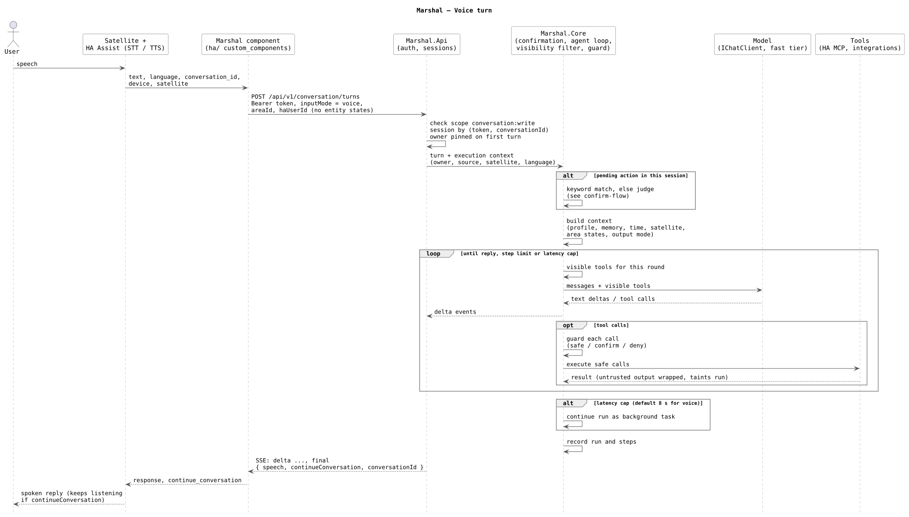
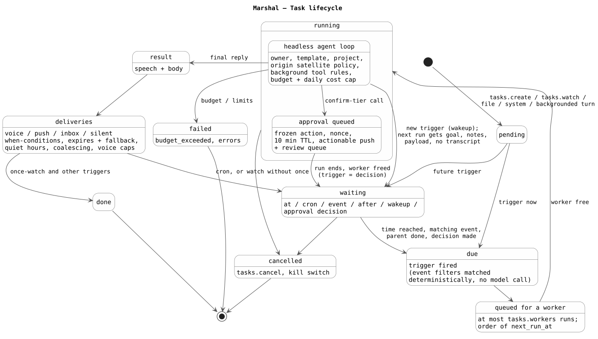

# Diagrams

PlantUML diagrams of the packages, the data model and the main flows, rendered from the sources in this folder. How to keep them current and render them is in [maintaining the diagrams](README.md).

## Packages

## Data model

## Voice turn

## Confirm-tier action

## Task lifecycle

