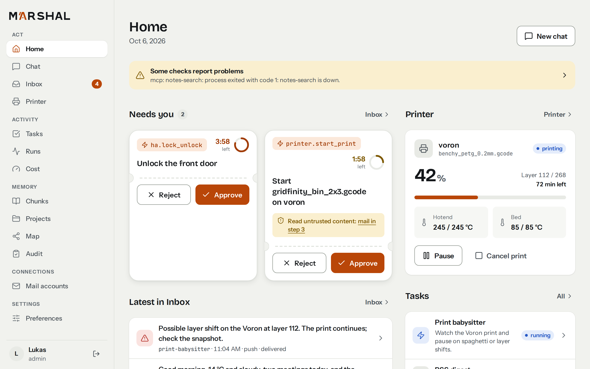
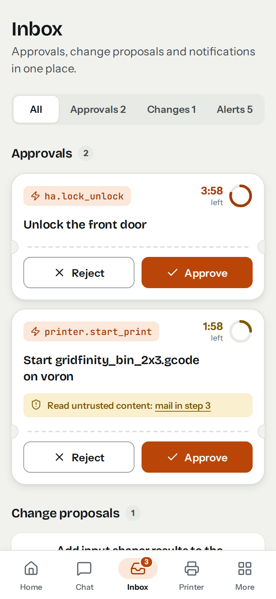
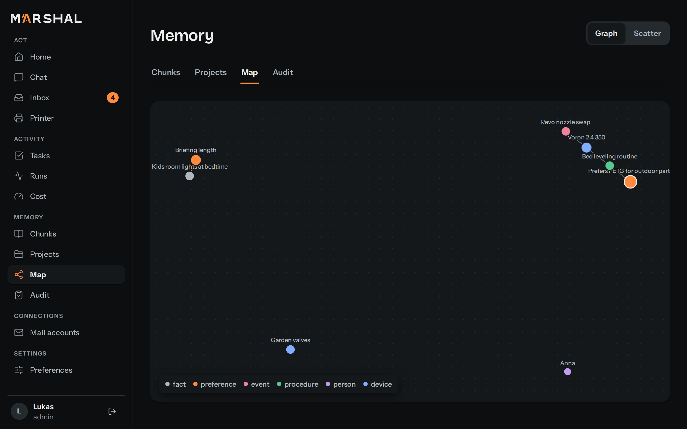

# Tour of the web UI

Find your way around Marshal's web app: what each destination shows and what you can do there.

## Before you start

- Open Marshal over HTTPS (through your [reverse proxy](../../installation/reverse-proxy.md)). Browser sessions do not work over plain HTTP.
- Sign in with a [local account](../authentication/local-accounts.md) or [OIDC](../authentication/oidc.md).

## Layout

On desktop a grouped side navigation lists every destination. On a phone a bottom bar shows Home, Chat, Inbox, Printer and More. More opens the rest. Destinations that need you (pending approvals, open proposals, unread critical notifications) show a count badge.

Every view works at phone width. The views you act on (Home, Inbox, Chat, Printer) are designed phone-first. The views you manage (memory, runs, cost, configuration, mail accounts, security) are designed desktop-first and may show a reduced layout on a phone.

## Destinations

| Group | Destination | What it does |
|---|---|---|
| Act | Home | What needs you first: pending approvals with approve and reject, printer alerts, running tasks and next runs, recent notifications. The kill switch appears while background tasks run. |
| Act | Chat | Text chat with Marshal. Replies stream in. Markdown, tables and code render; images show only from Marshal's own origin. Artifacts appear inline (images) or as cards that open the viewer. Earlier conversations, typed and spoken, are listed next to the chat. |
| Act | Inbox | The one place for everything that waits for you: approvals (frozen action, reasons, time left), coding proposals (diff, merge or reject) and the notification history, filterable by outcome. |
| Act | Printer | Live printer state. |
| Activity | Tasks | Tasks and watches with status, trigger, next run, budget and latest result. Edit a goal, cancel a task, use the kill switch. |
| Activity | Runs | What Marshal did, step by step, and why, including the reasoning of each model call (collapsed). |
| Activity | Artifacts | Files Marshal produced or received. See [artifacts](../artifacts.md). |
| Activity | Cost | Model usage and cost. |
| Memory | Chunks, Projects, Map, Audit | See and edit everything Marshal remembers. See [memory](../memory.md). |
| Connections | Mail accounts | Connect mail accounts. See [mail](../integrations/mail.md). |
| Settings | Preferences | Language, time zone, appearance, quiet hours, notification targets, do-not-disturb. |
| Settings | Security | API tokens, passkeys and secrets. |
| Settings | System | Health and the kill switch. |
| Settings | Configuration | Read-only view of loaded configuration. Admins only. |

## Approvals from a push notification

Tapping a push notification for an approval opens a focused approval screen. It shows the frozen action, its arguments and the time left, with approve and reject reachable without scrolling. Approve, reject and merge are audited user actions. See [approvals](../tasks/approvals.md).

## Chat history

The chat keeps your conversations. On desktop the list of earlier conversations sits next to the chat, newest first. On a phone, the history button in the chat header opens it. Each conversation has its own address (`/chat/{id}`), so a reload or a bookmark brings it back.

- **Web conversations** continue where you left off, whatever time has passed. After a few idle minutes the conversation rests: a pending confirmation is dropped and Marshal summarizes the new turns into memory, but the next message continues the same conversation.
- **Voice conversations** from Home Assistant satellites are listed with a microphone and the satellite or area. Each spoken turn is marked. They are read-only in the web chat: continue them by voice, or start a new chat.
- **API conversations** are marked "API" and are read-only too.

## Reasoning and tool steps in the chat

While Marshal works on a reply, the chat shows what it does:

- **Reasoning.** If the model has `reasoning` set (see [models](../../configuration/marshal-yaml/models.md)), its reasoning streams into a block above the reply. The block is open while the model reasons and folds away when the reply text starts. Select "Reasoning" to open or close it. The text is shown as written, never as Markdown, so links and images in it stay inert.
- **Tool steps.** Each tool call is one line: the tool's name, a short summary of its arguments, its state (running, done, failed, not allowed, waiting for confirmation), how long it took and a short result. Results of sensitive tools, such as mail and notes, are never summarized. Progress messages of the turn appear in the same list.

"Thinking…" shows only until the first of these arrives. A reopened conversation shows both, collapsed. Reasoning that followed private content (a mail or a note) is not kept; the chat then shows a note instead. Voice turns never request reasoning, and Home Assistant and API clients never receive reasoning or tool steps.

## Background results in the chat

When a turn takes too long, or Marshal moves it to the background itself, the reply says Marshal is working on it. When the background task finishes, its result appears in the same conversation as a reply marked "Background result", without a reload. The Inbox still receives the result as well. If the connection dropped in the meantime, the chat loads the conversation again when it reconnects. In the next turn, Marshal knows the result, so you can ask follow-up questions about it.

## Chat confirmations

When a turn ends with a pending action, the chat shows the question with its reason. Type "confirm" to approve.

## Configuration view

Admins see the loaded skills, templates, MCP servers (status and tool count), risk rules, models without secrets and satellite profiles, plus the last reload error per file. If a reload of `risk.yaml` failed, the view shows the error and that the previous rules stay active. The view does not edit files.

## Errors

Every failed request shows a message in your interface language: next to the form (your input stays), as a "could not load" state with a retry, or in a global banner. An expired session returns you to the login page with a "session expired" message and brings you back afterwards. For an unexpected server error the trace id is shown so you can find it in the log.

## Appearance and language

See [language and appearance](language.md) and [install as an app](install-as-app.md).

## Related

- [Notifications](../notifications.md)
- [Observability](../observability.md)
